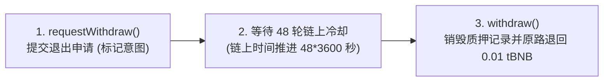

# PoolCoin RC2 测试网矿工快速操作指引 (M1 有人协助测试)

> [!IMPORTANT]
> **测试网环境与免责提示**  
> 1. 本指引专供 **PoolCoin RC2 (BSC Testnet, chainId 97)** 的 **M1 阶段（有限受邀、有人协助）** 测试者使用。测试网上的 tBNB 及 TTK 代币仅用于协议功能闭环验证，**无任何真实货币价值**。  
> 2. 测试网可能因治理演练、参数校准或升级验证随时发生重启、暂停或重新部署。  
> 3. **实机记录与验收范围说明**：本指引核心流程已在 Epoch 122 完成 GPU 实机闭环验证（详见证据报告 [rc2-gpu-live-e122-evidence.md](rc2-gpu-live-e122-evidence.md)）。必须明确：该实机记录基于现有开发机器及既有成熟押金账户，**并非新用户从零安装、新钱包首次存入质押或本金退出的完整验收**。在干净的独立环境实测前，仍需谨慎核对各环节条件。  
> 4. **零私钥泄露原则**：本指引全程强制采用 Foundry 加密 Keystore 托管机制。严禁在终端明文输入私钥，严禁配置包含私钥的环境变量，严禁向任何第三方或 AI 透露密码与私钥。

---

## 1. 代码获取、版本核验与工作目录

### 1.1 获取受控发布包
目前 PoolCoin 测试网处于受控内部测试阶段，**尚未发布公共 GitHub Release 标签或开放式仓库克隆**。  
所有参与 M1 测试的矿工均由**测试协调员直接分发固定版本的打包代码压缩包**（如 `poolcoin-rc2-m1.zip`）。

### 1.2 解压与工作目录确认
将压缩包解压至本地专用测试目录，例如：
```text
D:\project\poolcoin-rc2
```
打开 Windows PowerShell，进入该根目录并核验目录结构：
```powershell
# [本地检查] 切换至工作目录并确认关键子目录存在
Set-Location -Path "D:\project\poolcoin-rc2"
Get-ChildItem -Directory script, src, test
```
若解压目录缺失 `script`、`src` 或 `test` 目录，请立即联系协调员重新获取。

---

## 2. 运行环境与依赖检查

首版主路径严格限定为：**Windows 10 / 11 + PowerShell 5.1 或 PowerShell 7+**。

### 2.1 Python 环境统一性与版本证据说明
- **实测验证环境**：本次离线回归与 Epoch 122 GPU 实机闭环验证均在 **Python 3.14.5** 环境下执行通过。
- **兼容性边界**：该实测结果**不是所有 Python 版本的兼容证明**。常规推荐范围（Python 3.10 ~ 3.12）主要基于主流依赖库生态基线，但**这些版本未在本轮中进行实测验收**，请勿擅自扩大版本支持承诺。
- **环境统一性（避免环境错位）**：在 Windows 多 Python 环境共存时，直接运行全局 `pip` 极易将依赖安装到系统全局路径，导致执行 `python script/...` 时仍然抛出 `ModuleNotFoundError`。**强制要求**始终使用 `python -m pip` 确保依赖安装与当前执行的 Python 解释器严格绑定在同一环境。

```powershell
# [只读检查] 确认当前 Python 解释器路径及 pip 所属环境
python -c "import sys; print('Python executable:', sys.executable)"
python -m pip --version
```

### 2.2 安装核心基础依赖
```powershell
# [本地执行] 安装签名、RPC 通信与加密核心库
python -m pip install pycryptodome requests web3
```

### 2.3 GPU 挖矿分支可选依赖（仅限 GPU 挖掘分支）
若矿工计划选择 **分支 B (GPU 挖矿)**，需额外安装 OpenCL 绑定及数值计算库（并确保独立显卡驱动自带的 OpenCL Runtime 正常）：
```powershell
# [本地执行] 安装 GPU 计算依赖
python -m pip install pyopencl numpy
```

### 2.4 安装与核对 Foundry (`cast`)
Foundry 提供本地加密密钥托管与零明文私钥交互支持。请确认 `cast` 命令可用：
```powershell
# [只读检查] 确认 cast 已安装就绪
cast --version
```
若提示找不到命令，请先访问 [Foundry 官方安装指引](https://book.getfoundry.sh/getting-started/installation) 安装并在环境变量中生效。

---

## 3. 网络身份、RPC 节点与核心合约配置

### 3.1 统一 RPC 节点配置与 chainId=97 检查
在 PowerShell 会话中设置统一的 RPC 变量：
```powershell
# [会话配置] 设置默认 RPC 节点（本次实机验证跑通节点）
$RPC_URL = "https://bsc-testnet-rpc.publicnode.com"

# [备用节点] 备用公开节点（未在本次用户网络下完整验证通过，仅作备用切换）：
# $RPC_URL = "https://data-seed-prebsc-1-s1.binance.org:8545"
```

> [!CAUTION]
> **广播前强制链身份核验**  
> 公开 RPC 节点不承诺 100% 永久在线，历史归档状态可能随时受到限制。  
> **在发送任何交易之前，必须执行以下命令核验 chainId 必须为 97 (BSC Testnet)**。若切换备用节点，必须重新核验：
> ```powershell
> # [只读检查] 必须返回 97
> cast chain-id --rpc-url $RPC_URL
> ```

### 3.2 核心合约固定地址
在 PowerShell 会话中初始化核心合约地址变量：
```powershell
$MINER = "0x565D06e8d0313E2f8b5aa4b19DE569ca2200C4cf"
$VAULT = "0x40b92431de886Ea46117407c8f7123a31FB3F744"
$TOKEN = "0x4ca603774D8D3750481007683ce44C7d4c9b2C8d"
$TIMELOCK = "0x038f2377A32581Dc3aa8d9f18386619cf72C832e"
```

| 合约实体 | 链上地址 (BSC Testnet / chainId 97) | 职能说明 |
| :--- | :--- | :--- |
| **Miner (业务代理)** | `0x565D06e8d0313E2f8b5aa4b19DE569ca2200C4cf` | 矿工提交算力份额 (`submitShares`)、查询轮次与领取奖励 (`claim`) 的唯一业务入口 |
| **StakeVault (质押金库)** | `0x40b92431de886Ea46117407c8f7123a31FB3F744` | 0.01 tBNB 保证金存入 (`deposit`)、退出申请 (`requestWithdraw`) 与退款 (`withdraw`) 入口 |
| **Token (TTK 代币)** | `0x4ca603774D8D3750481007683ce44C7d4c9b2C8d` | ERC-20 挖矿产出代币，仅 Miner 代理具备铸造权限 |
| **TimelockController** | `0x038f2377A32581Dc3aa8d9f18386619cf72C832e` | 治理时间锁合约（Miner 与 StakeVault 的 `admin()` 拥有者） |

---

## 4. 账户准备、预算与安全准则

### 4.1 独立专用测试钱包原则
**严禁使用存放有主网真实高价值资产的私钥或助记词！** 请创建全新的专用测试钱包用于参与 PoolCoin 测试网。

### 4.2 导入并核验 Foundry Keystore
运行交互式命令，按提示粘贴测试私钥并设置本地加密保护密码：
```powershell
# [本地交互] 导入测试私钥至加密 Keystore，将 <YOUR_ACCOUNT_NAME> 替换为本地钱包别名（如 miner01）
cast wallet import <YOUR_ACCOUNT_NAME> --interactive
```
导入完成后，核验钱包地址及本地 Keystore 列表：
```powershell
# [只读检查] 查询本地 Keystore 对应地址
cast wallet address --account <YOUR_ACCOUNT_NAME>

# [只读检查] 列出所有受管理的本地 Keystore
cast wallet list
```
记下输出的地址，在 PowerShell 会话中设置变量：
```powershell
$MINER_ADDR = "<YOUR_MINER_ADDRESS>"
$ACCOUNT_NAME = "<YOUR_ACCOUNT_NAME>"
```

### 4.3 准备受保护的临时密码文件
自动化脚本与 `cast send` 需要密码解密 Keystore。请在本地安全位置创建密码文件（如 `C:\testnet-secrets\pwd.txt`），将单行密码写入该文件。
```powershell
# [会话配置] 设置密码文件路径变量（占位符示例，请勿将含真实密码的文件提交至 Git）
$PASSWORD_FILE = "C:\testnet-secrets\pwd.txt"
```
> [!CAUTION]
> 请确保该密码文件仅限当前 Windows 登录用户可读。切勿将该文件放在代码仓库或公开共享目录中。

### 4.4 测试代币预算与 Gas 原则
通过 BSC Testnet 官方水龙头为 `$MINER_ADDR` 充入测试用 tBNB。
- **协议硬性保证金**：`0.01 tBNB`（存入 StakeVault，退出时 100% 原路返还）。
- **手续费留存建议**：建议账户至少保留 `0.005 tBNB` 作为各项交易（质押、提交份额、领取奖励、退出）的 Gas 预算。
- **免责声明**：`0.015 tBNB`（0.01 质押 + 0.005 Gas）仅为**单轮测试的预估预算**，不构成对高频重试、极端网络拥堵或高 Gas 费率下的绝对保证。若余额低于预估费用，必须停止操作并补充 tBNB。

---

## 5. 保证金存入 (Deposit) 完整五步闭环

在 PoolCoin 协议中，矿工必须先向 `StakeVault` 质押固定保证金方可具备有效算力资格。

> [!NOTE]
> 当前测试客户端脚本库中暂未封装独立的 `deposit.py`。M1 阶段在测试协调员协助下，通过底层标准工具 `cast` 执行规范的“查询-模拟-估费-广播-核验”五步流程。

### 步骤 1：存入前只读状态核对
```powershell
# [只读检查] 1. 核验金库未处于紧急暂停状态（必须返回 false）
cast call $VAULT "paused()(bool)" --rpc-url $RPC_URL

# [只读检查] 2. 核验矿工当前未质押（必须返回 false 0）
cast call $VAULT "status(address)(bool,uint256)" $MINER_ADDR --rpc-url $RPC_URL
```

### 步骤 2：地址级调用仿真预检 (Dry-Run 模拟)
```powershell
# [只读模拟] 使用矿工真实地址模拟 deposit() 调用，确保无 Revert
cast call $VAULT "deposit()" --value 0.01ether --from $MINER_ADDR --rpc-url $RPC_URL
```
若返回空或无报错，说明模拟执行通过。若报错，请勿继续。

### 步骤 3：Gas 与交易费用审阅
```powershell
# [只读估算] 估算存入交易所需 Gas 数量（通常约 50,000 ~ 80,000）
cast estimate $VAULT "deposit()" --value 0.01ether --from $MINER_ADDR --rpc-url $RPC_URL
```

### 步骤 4：确认发送存入交易 (签名广播)
```powershell
# [签名广播] 向 StakeVault 存入 0.01 tBNB 保证金
cast send $VAULT "deposit()" --value 0.01ether --account $ACCOUNT_NAME --password-file $PASSWORD_FILE --rpc-url $RPC_URL
```
命令成功提交后将输出交易哈希 `<TX_HASH>`。

### 步骤 5：核验交易回执与状态变更
```powershell
# [只读检查] 1. 查询交易回执（必须确认 status 为 0x1 或 1）
cast receipt <TX_HASH> --rpc-url $RPC_URL

# [只读检查] 2. 确认金库状态变为 active=true，并记录存入轮次 <DEPOSIT_EPOCH>
cast call $VAULT "status(address)(bool,uint256)" $MINER_ADDR --rpc-url $RPC_URL

# [只读检查] 3. 查看金库详细存储记录 (depositEpoch, withdrawReqEpoch, has, depositAmount)
cast call $VAULT "stakes(address)(uint64,uint64,bool,uint128)" $MINER_ADDR --rpc-url $RPC_URL
```
*记下输出中的 `<DEPOSIT_EPOCH>`（即 `since`）。*

---

## 6. Ramp 预热限制与等待跨轮规则

> [!WARNING]
> **存入当轮不可提交（核心协议安全防线）**  
> 源码依据：`src/MinerV1.sol:317`：  
> `if (!active || e < since + 1) revert NoActiveStake();`  
> 矿工存入保证金的当期轮次（`<DEPOSIT_EPOCH>`）**绝对不能提交份额**，否则交易必然回滚！

### 6.1 轮次时间与判定机制（删除“自然整点”误区）
- **非挂钟整点规则**：协议的 `epoch` 计算以链上区块时间戳为准：`epoch = (block.timestamp - START) / 3600`。严禁凭借本机时钟或现实世界的“整点”放行提交。
- **首次可提交轮次 (First Submittable Epoch)**：必须等待链上当前 `epoch` 满足：
  $$\text{Current Epoch} \ge \text{since} + 1$$
  首次可提交时，算力权重处于初始预热状态（基础权重为 25%）。

### 6.2 Ramp 权重递增与满权重公式
- **权重计算源码**（`src/MinerV1.sol:318-320`）：
  ```solidity
  uint256 age = e - (since + 1);
  if (age > 24) age = 24;
  w = 2500 + (10000 - 2500) * age / 24;
  ```
- **满权重轮次 (Full Ramp Epoch)**：当 $\text{age} \ge 24$ 时（即 $\text{Current Epoch} \ge \text{since} + 25$），权重达到上限 10,000 (100%)。
- **关键机制澄清**：该递增完全基于**存款持有时间（Deposit Age）**的自然增长，**并不要求矿工每轮连续参与或连续提交**。即使中间某些轮次未挖矿，只要质押未申请退出，随着链上时间推进，权重仍会自然到达 100%。

### 6.3 检查是否已跨入可提交轮次
```powershell
# [只读检查] 查询链上当前进行中的 Epoch
cast call $MINER "epoch()(uint256)" --rpc-url $RPC_URL
```
*当且仅当返回的数字严格大于 `<DEPOSIT_EPOCH>` 时，方可进入 PoW 求解与份额提交！*

---

## 7. 轮次前置检查 (Preflight Check)

在启动任何计算前，运行全景状态查看工具：
```powershell
# [只读检查] 运行状态工具查看当轮协议健康度
python script/status.py --miner $MINER_ADDR --rpc $RPC_URL --miner-contract $MINER
```

**放行核验三要素**：
1. **`epochSeed != 0x0`**：当轮种子必须已经由 Keeper 或前序交互初始化完成。若显示为 `0x0`，**严禁盲目开跑，必须停机并联系测试协调员**（不要自行启用 `--allow-backfill` 发送私钥交易）。
2. **`lastSynced == epoch`**：合约历史结算未发生大幅落后（若滞后超过 48 轮将触发 `SyncingRequired` 阻断领取）。
3. **`paused == false` 且 `submissionsPaused == false`**：系统处于正常允许提交状态。

---

## 8. PoW 求解与生成 Share 文件 (CPU / GPU 二选一)

矿工根据本地硬件条件选择一条计算路径执行。

> [!NOTE]
> **术语与规则警示**  
> 1. **有效份额 vs 出块**：PoolCoin 矿工提交的是经过 PoW 验证的**算力份额 (share)**，并不是在 L1 区块链上“出块”。  
> 2. **防覆盖与索引 $k$**：每个 epoch 内单个地址最多提交 6 份 share，索引必须在 `0..5` 之间。默认输出 `k=0` 到 `share_k0.json`。若要在同轮继续挖掘第二份 share，必须显式指定 `--k 1 --out share_k1.json`。**严禁在同轮重复提交相同的 $k$，否则触发 DuplicateShareIndex 回滚**。  
> 3. **PoW 耗时承诺**：PoW 求解属于离散泊松随机过程，耗时取决于实际算力与全网难度，**不承诺任何固定的计算耗时**。

### 分支 A：CPU 挖矿 (`script/miner.py`)
```powershell
# [本地计算 + 会写文件] 运行 CPU 挖矿，成功找到有效 share 后将结果写入 share_k0.json
python script/miner.py --miner $MINER_ADDR --out share_k0.json --rpc $RPC_URL --miner-contract $MINER
```

### 分支 B：GPU 挖矿 (`script/miner_gpu.py`)
```powershell
# [本地计算 + 会写文件] 运行 GPU 挖矿，成功找到有效 share 后将结果写入 share_k0.json
python script/miner_gpu.py --miner $MINER_ADDR --out share_k0.json --rpc $RPC_URL --miner-contract $MINER
```

> [!TIP]
> **GPU 进度百分比超过 100% 的数学含义**  
> GPU 挖矿终端输出中的 `Done: 115.00%` 表示当前已扫描的 Nonce 数量超过了理论平均期望值（泊松分布数学期望）。  
> 泊松过程中，有约 36.8% 的概率单次搜寻哈希数会超过 100% 期望值。这属于**正常的随机波动，不代表程序卡死，也不代表即将完成或保证命中**，显卡仍在正常算力搜寻中。

> [!NOTE]
> **GPU 求解已知文案与元数据不一致说明**  
> 在当前实机求解中可能观察到：终端顶部难度显示为 `32.00 bits`，但成功提示文案仍包含 `required >= 31`，且生成的 JSON 文件中存在 `"difficultyBits": 31` 与 `"actualDifficultyBits": 32`。  
> 此现象属于**待独立修复的元数据与文案不一致**。份额的实际有效性严格依据链上 `target`、密码学 share 校验以及后续的仿真与合约调用，**严禁要求用户手动修改 share JSON 文件**。

### 跨 Epoch 过期 Share 的失效规则（关键防踩坑）
- 依据 `src/MinerV1.sol:338`：`if (e != epoch()) revert FutureEpoch();`。
- PoW 份额在生成时已经严格绑定了当时的 `epoch` 和 `epochSeed`。**如果在求解完成前或准备提交前，链上已经跨入下一轮次，该 share 永久失效作废！**
- **严禁**手动修改 JSON 文件中的 `epoch` 或 `seed`。因为 PoW 校验 `keccak256(epochSeed, miner, k, nonce) < target` 强依赖初始种子，篡改字段会导致哈希不匹配直接报错。
- **正确处置**：直接废弃该过期文件，重新确认新轮次 seed 就绪后，重新开始计算。

---

## 9. 份额提交 (Submit Share)

份额提交严格执行“只读仿真预检”与“签名广播确认”两步。

> [!NOTE]
> **单轮 6 份上限 vs 20% 奖励上限的区别**  
> - **6 份提交上限 (`CAP = 6`)**：单地址单轮最多成功提交 6 份 share。第 7 份提交将在合约层触发 `AddressCapExceeded` 错误导致交易回滚。  
> - **20% 奖励截断**：在后续领取奖励时，单个矿工无论提交多少算力，最多只能分得当轮有效总配额的 20%（`maxAmt = (effQ * 2000) / 10000`）。超出部分会自动回流至未发行池，**不会导致交易回滚**。

### 步骤 1：Dry-Run 仿真预检 (只读模拟)
```powershell
# [只读模拟] 不带 --send 参数，执行完整 eth_call 预检并查看 Gas 与费率估算
python script/submit_share.py --file share_k0.json --miner $MINER_ADDR --account $ACCOUNT_NAME --password-file $PASSWORD_FILE --rpc $RPC_URL --miner-contract $MINER
```
*注：若使用 `--account`，CLI 要求必须同时提供 `--password-file`。*

**预期仿真成功输出特征**：
```text
[SUCCESS] Preflight simulation passed! Estimated gas: 154,230
Gas Limit Ceiling:        204,230
Max Gas Fee Ceiling:      0.000613 BNB
==================================================
SIMULATION COMPLETED (DRY-RUN)
No transaction was sent to the blockchain.
==================================================
```
确认退出码为 0，且无任何 Revert 报错。

### 步骤 2：确认签名广播 (`--send`)
```powershell
# [签名广播] 显式添加 --send 广播上链
python script/submit_share.py --file share_k0.json --miner $MINER_ADDR --account $ACCOUNT_NAME --password-file $PASSWORD_FILE --send --rpc $RPC_URL --miner-contract $MINER
```
- 脚本会打印交易概览并暂停提示：  
  `Are you sure you want to broadcast this transaction to BSC Testnet? (type 'yes' to broadcast):`
- 输入 `yes` 回车确认发送。

**预期广播成功输出特征**：
```text
[BROADCAST SUCCESS] Transaction Hash: 0x...
Waiting for transaction confirmation on-chain...
[CONFIRMED] Transaction included in Block #...
Share successfully submitted and recorded in MinerV1!
```

> [!CAUTION]
> **严禁盲目重试！**  
> 若广播后遇到网络超时或未在 60 秒内查到回执，**严禁再次运行命令重发**（以免造成重复提交或 Gas 浪费）。请先复制交易哈希，执行 `cast receipt <TX_HASH> --rpc-url $RPC_URL` 确认链上真实状态。

### 步骤 3：提交后链上状态核验 (只读)
```powershell
# [只读检查] 查看当轮该地址计入的 share 份数（应显示 1）
cast call $MINER "counted(uint256,address)(uint8)" <EPOCH> $MINER_ADDR --rpc-url $RPC_URL
```

---

## 10. 等待轮次结束与领取奖励 (Claim)

### 10.1 轮次结束确认
矿工的挖矿产出奖励必须在**目标挖矿轮次完全结束**后方可领取。  
查询当前链上轮次：
```powershell
# [只读检查] 确认当前链上 epoch > <MINED_EPOCH>
cast call $MINER "epoch()(uint256)" --rpc-url $RPC_URL
```

### 步骤 1：Dry-Run 仿真领取预检 (只读模拟)
```powershell
# [只读模拟] 不带 --send 参数，预检可领 TTK 代币数量与 Gas 估算
python script/claim.py --epoch <MINED_EPOCH> --miner $MINER_ADDR --account $ACCOUNT_NAME --password-file $PASSWORD_FILE --rpc $RPC_URL --miner-contract $MINER
```
**预期预检成功输出特征**：
```text
[DRY RUN] 预检成功完成。当前为只读模拟模式，尚未广播链上交易。
```
终端将显示预估或已结算的 TTK 代币收益明细。

### 步骤 2：确认签名广播领取交易 (`--send`)
```powershell
# [签名广播] 显式添加 --send 广播领取交易
python script/claim.py --epoch <MINED_EPOCH> --miner $MINER_ADDR --account $ACCOUNT_NAME --password-file $PASSWORD_FILE --send --rpc $RPC_URL --miner-contract $MINER
```
- 输入 `yes` 确认发送。

**预期领取成功输出特征**：
```text
[广播成功] 交易哈希: 0x...
正在等待区块链打包上链确认...
[交易成功] 交易已在区块 #... 确认！
成功领取 Epoch <MINED_EPOCH> 奖励 ... TTK！
```

### 步骤 3：领取后核账与余额核查 (只读)
```powershell
# [只读检查] 1. 确认该轮该矿工已被标记为 claimed=true
cast call $MINER "claimed(uint256,address)(bool)" <MINED_EPOCH> $MINER_ADDR --rpc-url $RPC_URL

# [只读检查] 2. 查看矿工当前持有的 TTK 代币总余额 (18 位精度)
cast call $TOKEN "balanceOf(address)(uint256)" $MINER_ADDR --rpc-url $RPC_URL
```

---

## 11. 退出质押与保证金取回全路径 (Request & Withdraw)

若测试完成或不再参与挖矿，必须完整走完两阶段退出流程方可原路取回 `0.01 tBNB` 保证金：



> [!IMPORTANT]
> **关键状态与机制澄清**  
> 1. **`requestWithdraw` 成功不等于本金到账**：调用 `requestWithdraw()` 仅将金库状态中 `active` 置为 `false` 并记录申请轮次，**本金仍在金库中**。  
> 2. **退出冷却期间绝对无法再次 deposit**：根据 `src/StakeVault.sol:94`，存入要求 `!stakes[msg.sender].has`。由于申请退出后 `has` 依然为 `true`，**在调用 `withdraw()` 彻底结清并删除记录前，严禁尝试重新存入，否则必回滚 `BadDeposit`**。  
> 3. **冷却期精确数学公式**：  
>    - `requestEpoch` = 申请交易所在轮次 (`epoch()`)；  
>    - `storedWithdrawReqEpoch` = 金库存储字段，编码为 `requestEpoch + 1`；  
>    - 解锁轮次公式：  
>      $$\text{unlockEpoch} = \text{storedWithdrawReqEpoch} - 1 + \text{COOLDOWN\_EPOCHS} = \text{requestEpoch} + \text{COOLDOWN\_EPOCHS}$$  
>    （其中 $\text{COOLDOWN\_EPOCHS} = 48$）。该周期受链上出块时间戳驱动（48 × 3600 秒），并非本机时钟的绝对 48 小时。

### 阶段一：申请退出质押 (`requestWithdraw`)

#### 1. 状态核查与模拟预检 (只读)
```powershell
# [只读检查] 确认质押仍处于激活状态（返回 true）
cast call $VAULT "status(address)(bool,uint256)" $MINER_ADDR --rpc-url $RPC_URL

# [只读模拟] 模拟申请退出调用
cast call $VAULT "requestWithdraw()" --from $MINER_ADDR --rpc-url $RPC_URL

# [只读估算] 估算 Gas
cast estimate $VAULT "requestWithdraw()" --from $MINER_ADDR --rpc-url $RPC_URL
```

#### 2. 确认签名广播申请交易 (签名广播)
```powershell
# [签名广播] 提交退出申请
cast send $VAULT "requestWithdraw()" --account $ACCOUNT_NAME --password-file $PASSWORD_FILE --rpc-url $RPC_URL
```

#### 3. 回执核验与状态确认 (只读)
```powershell
# [只读检查] 1. 核验交易回执状态（status 需为 1）
cast receipt <TX_HASH> --rpc-url $RPC_URL

# [只读检查] 2. 核验金库状态中 active 变为 false
cast call $VAULT "status(address)(bool,uint256)" $MINER_ADDR --rpc-url $RPC_URL

# [只读检查] 3. 查看详细质押记录中的 withdrawReqEpoch (格式: depositEpoch, withdrawReqEpoch, has, depositAmount)
cast call $VAULT "stakes(address)(uint64,uint64,bool,uint128)" $MINER_ADDR --rpc-url $RPC_URL
```
*记下输出的第二项 `<WITHDRAW_REQ_EPOCH>`。解锁轮次为 `<WITHDRAW_REQ_EPOCH> - 1 + 48`。*

---

### 阶段二：冷却期满提取本金 (`withdraw`)

#### 1. 冷却期进度核查 (只读)
```powershell
# [只读检查] 查询当前链上 Epoch
cast call $VAULT "epoch()(uint256)" --rpc-url $RPC_URL
```
*必须确认当前 `epoch >= withdrawReqEpoch - 1 + 48` 后方可继续。*

#### 2. 提款模拟与 Gas 估算 (只读)
```powershell
# [只读模拟] 模拟提款调用（若冷却未满将抛出 CooldownActive）
cast call $VAULT "withdraw()" --from $MINER_ADDR --rpc-url $RPC_URL

# [只读估算] 估算提款 Gas
cast estimate $VAULT "withdraw()" --from $MINER_ADDR --rpc-url $RPC_URL
```

#### 3. 确认签名广播提款交易 (签名广播)
```powershell
# [签名广播] 结清质押并原路取回 0.01 tBNB
cast send $VAULT "withdraw()" --account $ACCOUNT_NAME --password-file $PASSWORD_FILE --rpc-url $RPC_URL
```

#### 4. 结清核验与资金到账确认 (只读)
```powershell
# [只读检查] 1. 确认回执 status 为 1
cast receipt <TX_HASH> --rpc-url $RPC_URL

# [只读检查] 2. 确认质押记录已被完全删除 (全部返回 0 或 false)
cast call $VAULT "stakes(address)(uint64,uint64,bool,uint128)" $MINER_ADDR --rpc-url $RPC_URL

# [只读检查] 3. 核对矿工账户 tBNB 余额已恢复入账
cast balance $MINER_ADDR --rpc-url $RPC_URL
```

---

## 12. 常见错误代码、触发条件与处置策略

在执行仿真或链上交互时，若遇到自定义 Revert 错误，请严格依照下表处理，**切勿盲目重复发交易**：

| 自定义错误代码 | 所属合约 | 触发原因 | 处理策略 |
| :--- | :--- | :--- | :--- |
| `BadDeposit()` | StakeVault | 1. 存入金额不等于 `0.01 ether`；<br>2. 地址已有质押记录（包括正处于退出冷却中的地址）。 | 核对 `--value 0.01ether`；若此前已申请退出，必须等待 48 轮冷却并执行 `withdraw()` 后方可重新质押。 |
| `NoStake()` | StakeVault | 未曾质押的地址尝试调用 `requestWithdraw()`。 | 确认调用方钱包地址是否正确。 |
| `CooldownActive()` | StakeVault | 申请退出后链上时间未满 48 轮冷却即尝试调用 `withdraw()`。 | 保持等待，查询链上 `epoch()` 直至满足解锁轮次。 |
| `NotStarted()` | StakeVault | 链上时间戳早于金库启动时间。 | 检查链上环境配置，联系测试协调员。 |
| `SendFailed()` | StakeVault | 向矿工返还 0.01 BNB 时转账失败。 | 通常由于接收地址为不接收原生代币的合约地址引发。EOA 账户不会出现此错误。 |
| `VaultIsPaused()` | StakeVault | 金库处于紧急暂停状态（仅阻断 `deposit`，不阻断 `withdraw`）。 | 联系协调员了解暂停原因，等待金库恢复。 |
| `SubmissionsPausedError()` | MinerV1 | 挖矿份额提交已被管理方暂停。 | 停止挖矿计算，等待维护完成。 |
| `BadBatchLength()` | MinerV1 | 提交的份额数组为空或长度大于 6。 | 检查提交文件，确保 share 列表非空且 $\le 6$。 |
| `SyncingRequired()` | MinerV1 | 轮次结算落后超过 48 轮，超出 claim 自动追赶阈值。 | 联系协调员或等待 Keeper 执行 `sync(48)` 追赶历史轮次。 |
| `SeedNotInitialized()` | MinerV1 | 提交份额时当轮种子 `epochSeed == 0`。 | **立即停机**。联系测试协调员核实 Keeper 种子生成状态。 |
| `FutureEpoch()` | MinerV1 | 提交份额的轮次不等于链上当前正在进行的轮次（`e != epoch()`）。 | **该 share 已过期作废**。严禁篡改文件，需废弃并针对新轮次重新开跑。 |
| `NoActiveStake()` | MinerV1 | 1. 矿工尚未质押；<br>2. 处于存入当期轮次（$e < \text{since} + 1$）；<br>3. 矿工已申请退出质押。 | 若刚存入，等待进入下一轮；若已申请退出，不可再参与挖矿。 |
| `AddressCapExceeded()` | MinerV1 | 单地址在单轮内累计提交有效 share 超过 6 份。 | 本轮额度已满，停止提交，等待下一轮。 |
| `InvalidShareIndex()` | MinerV1 | 份额索引 $k > 5$。 | 检查命令行 `--k` 参数，必须在 `0..5` 范围内。 |
| `DuplicateShareIndex()` | MinerV1 | 份额索引 $k$ 在当前轮次已被该地址成功提交过。 | 检查已提交的 $k$，下一份 share 必须使用未提交过的索引（如 `--k 1`）。 |
| `AlreadyClaimed()` | MinerV1 | 该轮次挖矿奖励已被领取。 | 查询代币余额，请勿重复发起领取交易。 |
| `ZeroWeight()` | MinerV1 | 目标轮次无任何有效算力份额计入。 | 该轮无法领取奖励。 |

---

## 13. 功能缺口与体验差距说明 (M1 vs M2)

客观说明当前版本的操作体验差距（属于后续版本演进项，不构成受邀协助模式下的阻断）：

| 体验缺口项 | 现状及临时指引 | M1 (受邀协助测试) | M2 (公开自主测试) |
| :--- | :--- | :---: | :---: |
| **缺少用户端 `deposit` / `withdraw` 脚本** | 当前依赖原生 `cast` 命令组合调用金库 | **不阻断**（有技术人员指导走通规范流程） | **体验欠缺**（后续需封装独立 CLI 工具） |
| **存入当轮不可提交的倒计时交互** | 合约底层 Revert `NoActiveStake`，无前置提示 | **不阻断**（文档与协调员已明确告知等待跨轮） | **体验欠缺**（客户端脚本需增加人性化倒计时） |
| **跨轮过期 Share 自动重算机制** | 矿工若跨轮提交会触发 `FutureEpoch` 报错 | **不阻断**（文档已指引主动核验 epoch 并废弃旧 share） | **体验欠缺**（需增加守护进程自动监听跨轮） |
