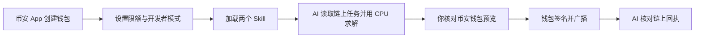
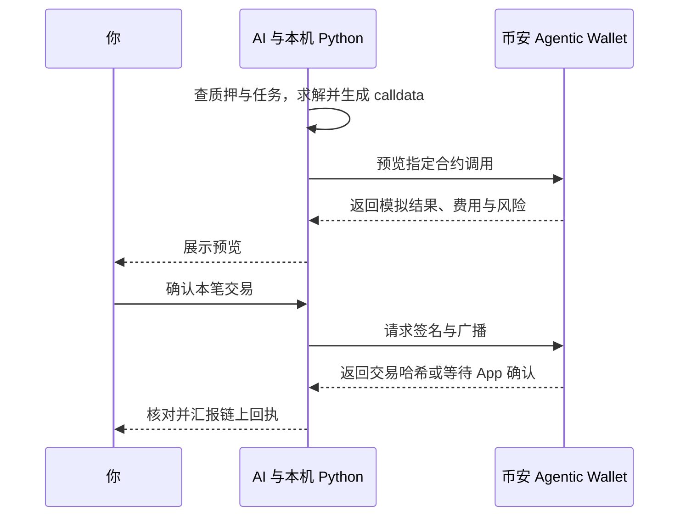

# 用币安 Agentic Wallet 挖 SparkHash

你在本机运行 AI 和 Python。Python 算出主网 share，币安 Agentic Wallet 预览并签名。质押、提交和领奖都需要你确认交易。



## 1. 创建钱包并转入 0.02 BNB

打开币安 App，在 **钱包 → Agentic Wallet** 入口创建专用钱包，打开收款页面，复制它在 **BNB Smart Chain（BSC）** 上的地址。向这个地址转入 **0.02 BNB**，转账时网络也选 BNB Smart Chain。检查 App 是否显示余额到账。 [币安 Agentic Wallet 官方说明](https://developers.binance.com/en/docs/products/agentic-wallet/welcome)

0.02 BNB 是示例入金额。当前质押要求为 0.01 BNB，剩余 BNB 用于 Gas；实际质押额以链上 `DEPOSIT()` 为准。钱包余额须覆盖质押及后续交易费用。

## 2. 设置每日限额与安全规则

在 App 的 Agentic Wallet 管理页打开右上角 **设置**，填写你能接受的每日消费上限。自定义合约调用需要开启 **开发者模式（Developer Mode）**，按 App 提示阅读并确认，然后设置该模式自己的每日限额。它和普通消费限额独立。建议为高风险交易保留 App 确认或拦截。 [币安设置说明](https://github.com/binance/binance-skills-hub/blob/main/skills/binance-web3/binance-agentic-wallet/references/wallet-setting.md) · [开发者模式说明](https://github.com/binance/binance-skills-hub/blob/main/skills/binance-web3/binance-agentic-wallet/references/external-sign.md#enabling-developer-mode)

授权 SparkHash Skill 只准备发往以下两个地址的交易。钱包若提供合约地址级限制，同样只放行这两个地址。SparkHash Skill 自身会核对目标和函数；币安转账地址簿是另一项设置。

- **StakeVault（质押与赎回）** `0x45eb4e8a7a3070c8160e9a91fae002934d296591`
- **Miner Proxy（提交与领奖）** `0x614b5efd21cfa99cb893abf2fb02d791b3aea843`

交易预览中，只有 `deposit()` 应带质押 BNB 金额。提交和领奖的交易 `value` 为 `0`，钱包仍会显示 Gas 费用。

## 3. 加载两个 Skill

电脑需要装有 Node.js、npm 和 Python 3。用终端安装官方钱包 Skill。随后按官方 Skill 的提示在币安 App 扫码登录和验证。 [官方安装入口](https://developers.binance.com/en/docs/products/agentic-wallet/welcome#install) · [官方登录流程](https://github.com/binance/binance-skills-hub/blob/main/skills/binance-web3/binance-agentic-wallet/references/authentication.md)

```bash
npx skills add binance/binance-skills-hub/skills/binance-web3/binance-agentic-wallet
```

把仓库中的整个 `skills/sparkhash-agentic-miner/` 目录导入你所用客户端的 Skills 目录，保留 `SKILL.md` 和 `solver.py` 的相对位置。在客户端里显式加载 `binance-agentic-wallet` 和 `sparkhash-agentic-miner`。在本地 Python 环境安装 solver 依赖，并从仓库根目录运行离线自测。

```bash
python -m pip install eth-abi 'eth-hash[pycryptodome]'
python skills/sparkhash-agentic-miner/solver.py --self-test
```

看到含 `to`、`data`、`value`、`summary` 的 JSON 表示自测通过。它使用合成任务，不连接钱包，也不需要发送这份交易数据。

## 4. 用一句话启动

在 AI 聊天里粘贴这句话，把地址换成你在第 1 步复制的地址。

> 用 Binance Agentic Wallet 和 SparkHash Skill，在 BSC 主网为我的钱包 `0x你的钱包地址` 接入 SparkHash。检查余额和安全限额，准备质押交易；确认并激活后自动用本机 CPU 挖矿，找到解就预览提交，有已结算奖励就预览领取 SPKH。每笔交易先给我看预览，等我确认再签名广播。

1. **先看质押预览。** 核对钱包地址、StakeVault、实际质押金额和手续费。确认交易后，最早从质押成功的下一 Epoch 开始提交。
2. **找到 share 后确认提交。** 预览应指向 Miner Proxy。CPU 可能整轮找不到解，或者在确认前已换轮；这时让 AI 读取新任务重新搜索。
3. **轮次结算后确认领奖。** 检查奖励属于哪个 Epoch，并核对 Miner Proxy 和手续费。交易成功后在钱包查看 SPKH，代币地址为 `0xcce53217a4f2850c536d751cfb676da26bd372dc`。



想停挖就让 AI 停止搜索。想赎回本金时另行要求申请退出，并在冷却达到 48 个链上 Epoch 后，再确认提款交易。已经计入的历史奖励仍可按条件领取。
